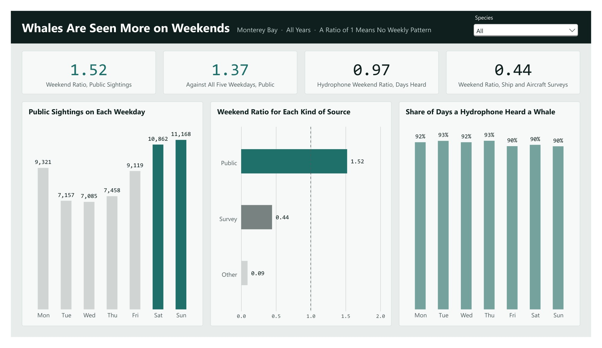

# Whales Only Exist on Weekends

Public whale sightings record when and where people go whale watching more than where the whales are. Open OBIS and iNaturalist data (about 110 GB) loaded into Snowflake, modelled with dbt into a tested star schema, each claim answered in a SQL notebook, and the story told in Power BI.

**Read the write-up:** [brandonconnely.com/portfolio/projects/whales](https://brandonconnely.com/portfolio/projects/whales) · **Notebooks:** [the six notebooks with their results](https://boaxes.github.io/Whales-Only-Exist-on-Weekends/) · **dbt docs:** [lineage and column docs](https://boaxes.github.io/Whales-Only-Exist-on-Weekends/dbt/) · **Power BI:** [`report/whales.pbix`](report/whales.pbix) (opens in the free Power BI Desktop, no Snowflake account needed)

| Claim | Result |
|---|---|
| Whales Are Seen More on Weekends | A weekend day carries 1.52× the public sightings of a Tuesday-to-Thursday day (95% range 1.42 to 1.63); the hydrophones hear whales as often on either |
| A Holiday Is Most of a Weekend | A weekday holiday carries 1.30× the public sightings of the same weekday a week before and after (95% range 1.11 to 1.54) |
| Sightings Follow the Boat Timetable | 44% of daylight public sightings fall between 10:00 and 11:59, and 89% while a scheduled trip is at sea |
| Sightings Stay Close to the Harbors | Half of public bay sightings are within 10.8 km of a harbor, against 25.2 km for ship and aircraft surveys |
| The Whales Stayed When the Boats Stopped | Spring 2020 public sightings fell 79% on 2019, while the hydrophones heard whales on 92 of 93 days |
| The Weekend Holds Along the Coast | Weekends are busier in 4 of 5 West Coast areas |

Each claim is one notebook and one Power BI page with the same title.



## How it is built

```
OBIS + iNaturalist open data (S3)
  -> Snowflake RAW                           load/
  -> dbt: the star schema in MARTS           dbt/
  -> Snowflake Notebooks, SQL only           analysis/
  -> Power BI (Snowflake connector)          report/
```

- `load/` Snowflake setup and loaders: the OBIS occurrence archive (188,230 West Coast cetacean records from 117 datasets, read inside Snowflake), the datasets' OBIS API records, and iNaturalist observations.
- `dbt/` the star, one model per table: `fct_sighting` (one row per whale record) and four dimensions, `dim_date` (when, with each day's count of iNaturalist observers in the bay), `dim_dataset` (who recorded it), `dim_species` (what) and `dim_location` (where: the area, and in Monterey Bay the nearest harbor). Four seeds, including `dataset_kind`, which sorts the 117 datasets by hand into public, survey, hydrophone and other. 21 tests on keys and joins.
- `analysis/` six Snowflake Notebooks, one per claim, SQL cells only (the 95% ranges too). Written by `analysis/notebooks_src/build.py`.
- `docs/notebooks/` the same six notebooks as static pages with their results: `analysis/notebooks_src/build.py` writes them as marimo notebooks, runs each once against Snowflake and exports it (the page style is beside it, in `site.css` and `head.html`); `docs/index.html` lists them, and `docs/dbt/` holds the dbt docs (`dbt docs generate --static`). Serve `docs/` with any static server (GitHub Pages, or `python -m http.server --directory docs`).
- `report/whales.pbix` the Power BI report, with its data inside: a model that mirrors the star column for column, measures only, with display names for the few values a reader sees, and one page per claim in Salish's colours. Open it in the free Power BI Desktop to click through every page; no Snowflake account is needed.
- `make_credits.py` writes CREDITS.md from the star and the OBIS API records.

Decisions worth knowing:

- Every weekend ratio sets the weekend against Tuesday to Thursday (`dim_date.is_weekend`, `is_midweek`): long weekends and holidays blur Mondays and Fridays.
- The 117 datasets are sorted by hand into public, survey, hydrophone and other (`dbt/seeds/dataset_kind.csv`, with a note on each); OBIS does not record which is which.
- Positions on an exact 0.1° grid point were rounded and can be several km off, so distance claims are given with and without them.
- Hours are the clock hour written on each record: only one timed record in seven states a zone across the coast (one in ten in the bay), nearly always a Pacific offset.
- The 95% ranges pick their resampled weeks with a hash, so every run gives the same range.

## Running it

You need a Snowflake account, a saved Snowflake CLI connection named `whales` (key-pair login), [uv](https://docs.astral.sh/uv/) and Power BI Desktop.

1. Run the scripts in `load/` in order (`snow sql -c whales -f load/01_setup.sql`, and so on; the Python loaders with `uv run python`).
2. `cd dbt && uv run dbt build`
3. Upload `analysis/*.ipynb` to a Snowflake Workspace (Add new, Upload files) and run them there, or run `uv run python analysis/notebooks_src/build.py` to rewrite them and rebuild the static pages.
4. To refresh the report from your own Snowflake, open `report/whales.pbix`, set the `SnowflakeServer` parameter to your account (Transform data, Edit parameters) and refresh; sign in with key pair.

## Credits

All whale records come from the [OBIS](https://obis.org) open-data archive; every dataset, licence and citation is in [CREDITS.md](CREDITS.md). The code and writing here are under the MIT licence ([LICENSE](LICENSE)); the data stays under each dataset's own licence.
